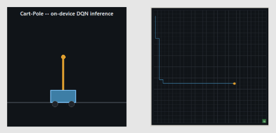

# RL on Embedded Systems


[](/LICENSE)

🎓 My Bachelor's final project at Isfahan University of Technology (IUT).



🏫 Implementation and evaluation of Reinforcement Learning algorithms on embedded systems, focusing on performance, resource constraints, and real-time interaction.

## 📌 Overview

Tabular Q-Learning and DQN on micro-controllers, trained **on the board** wherever memory allows. Every problem has a Python reference (`pc/`) and Arduino sketches (`arduino/`) built from the same environment and constants. Tested on Arduino Uno, NodeMCU (ESP8266) and STM32F407-Discovery, with Raspberry Pi 4 as a control group.

## 📄 Report

What was done and what came out of it: see [report.md](report.md).

## 📁 Structure

```txt
.
├── src/
│   ├── dpm/        # Dynamic Power Management (+ Safety Shield)
│   ├── grid/       # Grid-World navigation (Q-Learning, DQN)
│   └── cartpole/   # Cart-Pole balancing (Q-Learning, DQN)
├── tools/          # weights exporter (PyTorch -> C) and live serial visualizer
├── report.md
└── requirements.txt
```

Each problem folder has its own README.

## 🚀 Quick start

1. Set up a virtual environment

   ```bash
   python -m venv .venv
   source .venv/bin/activate        # Windows: .venv\Scripts\activate
   pip install -r requirements.txt
   ```

2. Run a PC reference

   ```bash
   python src/dpm/pc/train_qlearning.py
   ```

3. Run on a board

   Open `src/<problem>/arduino/<sketch>/<sketch>.ino` in the Arduino IDE, select the board, upload, and open the Serial Monitor at **115200 baud** to see the output.

4. Live visualizer (DQN demos)

   Upload `cartpole_dqn_demo` or `grid_dqn_demo`, then close the Serial Monitor (it blocks the port) and run:

   ```bash
   python tools/rl_serial_visualizer.py
   ```

Pick the board's serial port, click **Connect**, and the animation starts. Pause / Resume / Next Episode buttons control the board. On Linux, tkinter may need `sudo apt install python3-tk`.

## 🤝 Contributing

We welcome any contributions you may have. If you're interested in helping out, fork the repository
and create an [Issue](https://github.com/Mr-MRF-Dev/RL-on-Embedded-Systems/issues) or
[PR](https://github.com/Mr-MRF-Dev/RL-on-Embedded-Systems/pulls).

## 📄 License

This project is licensed under the MIT License. See the [LICENSE](/LICENSE) file for details.
